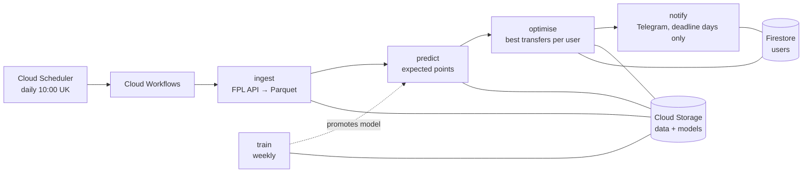

<p align="center">
  
</p>

# FPL Optimiser

[](https://github.com/jameso127/fpl-optimiser/actions/workflows/ci.yml)

**A bot that tells you which Fantasy Premier League transfers to make, and why.**

Every gameweek it predicts how many points each of the ~700 Premier League players will score,
works out the best transfers for your team, and messages you the advice on Telegram on the
morning of the deadline. It runs on Google Cloud for well under £2 a month (about 10p so far).

> **In short:** an end-to-end ML project. It covers data ingestion, a trained and backtested
> model, a mathematical optimiser and a deployed, scheduled pipeline, with CI/CD and
> infrastructure as code.

## What you get

On deadline day, two pictures and hardly any words (a real gameweek 6 recommendation):

<p align="center">
  
  
</p>

1. **Your team on a pitch**: club shirts, expected points (xPts) and fixture difficulty, with the
   captain, new signings and injury doubts marked.
2. **The transfers**: each swap as OUT ➜ IN with the expected-points gain, and a bar chart of
   both players' last five gameweeks on the same scale. Buttons underneath open FPL's transfer
   page.

The bot only recommends a transfer if it adds at least half a point: predictions are noisy, so a
marginal swap isn't worth the risk. Here the manager had 5 free transfers banked, so all five
swaps come at no cost. If the pictures can't be drawn for any reason, the same advice is sent as
text instead.

## Does the model work?

Yes, and the backtest checks it honestly. Every gameweek is predicted by a model that has only
seen earlier data ([full report](docs/backtest.md)):

| Head to head | Model | Other | Avg points of each gameweek's top-30 picks |
|---|---|---|---|
| vs a simple "recent form" baseline | **4.45** | 3.76 | model wins |
| vs FPL's own expected points (`ep_next`)* | **4.52** | 3.93 | model wins |

\* on the 9 gameweeks where FPL's pre-deadline figure is available.

## How it works



| Step | What it does |
|---|---|
| `ingest` | Saves a snapshot of the official FPL API (players, teams, fixtures, results). |
| `train` | Trains a model weekly, tests it, and only puts it live if it passes a quality gate. |
| `predict` | Uses the live model to predict every player's points for the next gameweek. |
| `optimise` | Finds each user's best team for 0 to 5 transfers, including the 4-point hits. |
| `notify` | Draws the pictures and sends them on Telegram, only on deadline days and never twice. |

The whole pipeline runs every morning, so the data and advice stay fresh, but `notify` only sends
when the next deadline is that day. Each step is a small container that runs, does its job and
stops, so it costs nothing while idle.

**Test run.** To see the message without waiting for a deadline, start the pipeline with a test
flag. It sends straight away, but only to users marked `tester: true`, and records nothing, so
the real deadline-day message still goes out:

```
gcloud workflows run fpl-pipeline --location europe-west2 --data='{"test":true}'
```

(In Windows PowerShell, escape the quotes: `--data='{\"test\":true}'`.)

## Engineering highlights

- **Optimisation as a maths problem.** The squad rules (15 players, 2/5/5/3 by position, at most
  3 per club, the budget, a valid formation, a captain) are encoded as a mixed-integer program
  and solved exactly with HiGHS (via SciPy).
- **Training is separate from serving.** Every trained model is saved with a "model card" (data
  hash, features, parameters, git commit). A new model only goes live if it beats both
  baselines and the current model, and `predict` refuses to run if the features don't match.
- **Handles the messy reality.** FPL hides transfers you've already made until the deadline
  passes, so users can tell the bot about them. Every message lists the assumptions it rests on.
- **Pictures, not paragraphs.** The pitch and transfer graphics are drawn in Python with Pillow
  and sent through the Telegram Bot API with link buttons. If drawing fails, the advice still
  goes out as text.
- **Safe to re-run.** Each job overwrites its own output, and sending is an atomic "claim" in a
  Firestore transaction, so a retry never sends a message twice.
- **Tested.** About 200 tests using fake data sources, plus contract tests that run the same
  suite against the real database (Firestore emulator) and an in-memory version.
- **Shipped through CI/CD.** Pull requests run lint, type checks, tests and Docker builds. Merging
  deploys only the parts that changed, using short-lived credentials and no stored keys.

## Lessons from building it

- **Data leakage.** An early version made FPL's own numbers look better than the model. The
  archived value turned out to contain the result it was meant to predict. The backtest now
  checks for this leak on every run.
- **Where the code runs matters.** The FPL API answered every request from Cloud Run in London
  (europe-west2) with a 403, whatever the HTTP client or headers. The same container in Belgium
  (europe-west1) works, so the jobs run there.

## What it costs

The target is under £2 a month; in practice it is about 10p, nearly all of it storing the
container images. Everything else fits in Google Cloud's free tiers:

| Part | Usage | Monthly cost |
|---|---|---|
| Artifact Registry | ~1.4 GB of images (the newest 5 versions are kept) | ~£0.08 |
| Cloud Run jobs | ~2 minutes a day, plus a weekly training run | free tier |
| Cloud Storage | ~15 MB of Parquet and models | under 1p |
| Workflows, Scheduler, Firestore, Secret Manager | a few calls a day | free tier |

## Tech stack

Python 3.12 · pandas · LightGBM · SciPy (HiGHS MILP) · Pillow · Telegram Bot API · Parquet · Docker ·
Google Cloud (Cloud Run Jobs, Workflows, Scheduler, Cloud Storage, Firestore, Secret Manager) ·
Terraform · GitHub Actions · uv · ruff · mypy · pytest

## Run it yourself

You need [uv](https://docs.astral.sh/uv/). Copy `.env.example` to `.env` and fill in your FPL
team id, a Telegram bot token (from @BotFather) and your chat id. Locally it runs in
single-user mode: you are the only user, so no database is needed.

```
uv sync
uv run python -m ingest.history   # once: download past seasons to train on
uv run python -m ingest.main      # today's FPL data -> ./data
uv run python -m train.main       # train, test and (maybe) promote a model
uv run python -m predict.main
uv run python -m optimise.main
NOTIFY_TEST=true uv run python -m notify.main   # send the message now
```

`make pipeline` runs all of these except the history import; `make lint` and `make test` run the
checks.

## Users

In the cloud, users live in Firestore (`users` collection), one document each:

| Field | Type | Meaning |
|---|---|---|
| `chat_id` | number | their Telegram chat id (this is the key; the document id doesn't matter) |
| `fpl_team_id` | number | their FPL team id |
| `active` | boolean | `false` pauses their messages |
| `tester` | boolean | optional: `true` to receive test runs |

## Repo layout

```
ingest/     FPL API -> Parquet, plus the one-off history import
ml/         features, model, registry, promotion gate, monitoring, backtest
train/      predict/     optimise/     notify/     one Cloud Run job each, with its Dockerfile
common/     shared settings, logging, storage, FPL client, users store, deadline rule
tests/      unit and contract tests, with fake data sources
docs/       backtest report and the README pictures (redraw: uv run python -m scripts.readme_images)
```

## Related repos

- [fpl-optimiser-infra](https://github.com/jameso127/fpl-optimiser-infra): all the Google Cloud
  infrastructure as Terraform (jobs, scheduler, workflow, storage, Firestore, IAM).

`archive/` holds the original single-file version of the optimiser, kept for comparison.
