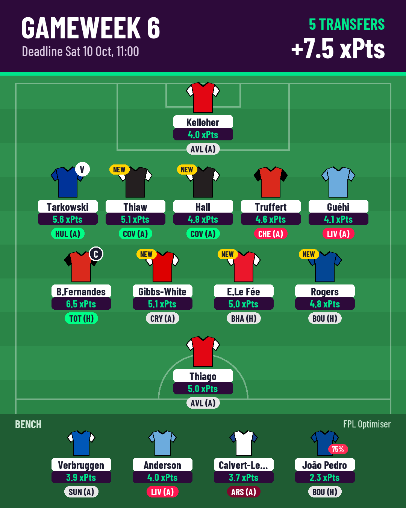
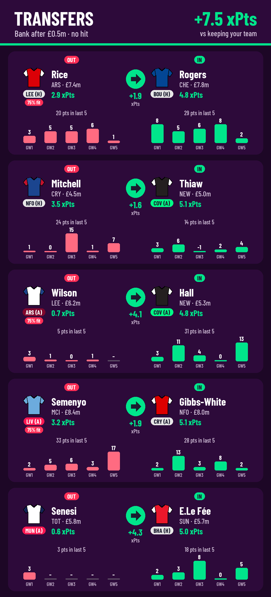

<p align="center">
  
</p>

# FPL Optimiser

[](https://github.com/jameso127/fpl-optimiser/actions/workflows/ci.yml)

**A bot that tells you which Fantasy Premier League transfers to make, and why.**

Every gameweek it predicts how many points each of the ~700 Premier League players will score,
works out the best transfers for your team, and messages you the advice on Telegram on the
morning of the deadline.

## What you get

On deadline day, two pictures and hardly any words (a real gameweek 6 recommendation):

<p align="center">
  
  
</p>

1. **Your team on a pitch**: club shirts, expected points (xPts) and fixture difficulty, with the
   captain, new signings and injury doubts marked.
2. **The transfers**: each swap as OUT ➜ IN with the expected-points gain, and both players'
   last five gameweeks. Buttons underneath open FPL's transfer page.

## How it picks your transfers

<p align="center">
  
</p>

1. **Predict every player.** A trained model gives each player an expected points score (xPts)
   for the next gameweek.
2. **Solve the squad puzzle.** Picking 15 players under FPL's rules (positions, at most 3 per
   club, the budget, a legal starting XI) is a mixed-integer program. The HiGHS solver finds the
   squad with the most expected points, **provably the best**, not a guess. It does this once
   for every number of transfers from 0 to 5, and picks the captain too.
3. **Decide how many transfers.** Each transfer beyond your free ones costs a 4-point hit, and
   predictions are noisy, so a transfer must earn at least **+0.5 points** to be worth making.
   In the example, with 1 free transfer only the first swap pays: a second would gain almost
   nothing after its hit. (The real manager had 5 free transfers banked, so all five swaps in the
   pictures above were free.)

## Does the model work?

<p align="center">
  
</p>

Every gameweek of the 2025-26 season was predicted by a model that had only seen earlier data,
and its 30 highest-rated players were compared with the picks of two alternatives. It beats
both, including FPL's own prediction. The backtest also checks for data leaking from the future
on every run. [Full report](docs/backtest.md).

## How it runs

<p align="center">
  
</p>

Each step is a small container on Google Cloud that starts, does its job and stops, so the whole
thing costs pennies a month. The data refreshes every day, but you only get a message on deadline
day, and never the same gameweek twice.

To see the message without waiting for a deadline, start a **test run**. It sends straight away,
only to users marked `tester: true`, and doesn't count as the gameweek's message:

```
gcloud workflows run fpl-pipeline --location europe-west2 --data='{"test":true}'
```

(In Windows PowerShell, escape the quotes: `--data='{\"test\":true}'`.)

## Under the hood

- **Python 3.12** with pandas and LightGBM for the model, SciPy's HiGHS for the optimiser, and
  Pillow for the pictures.
- **Google Cloud**: Cloud Run jobs, Workflows and Scheduler; Parquet files in Cloud Storage;
  users in Firestore. All of it is defined in Terraform in
  [fpl-optimiser-infra](https://github.com/jameso127/fpl-optimiser-infra).
- **Models are gated.** A newly trained model only goes live if it beats the baselines and the
  current model. Each one is saved with a model card: the data, features and git commit it came
  from.
- **CI/CD with GitHub Actions.** Pull requests run lint, type checks, about 200 tests and Docker
  builds. Merging deploys only the parts that changed, with no stored keys.

## Run it yourself

You need [uv](https://docs.astral.sh/uv/). Copy `.env.example` to `.env` and fill in your FPL
team id, a Telegram bot token (from @BotFather) and your chat id. Locally there is just one
user, you, so no database is needed.

```
uv sync
uv run python -m ingest.history   # once: download past seasons to train on
uv run python -m ingest.main      # today's FPL data -> ./data
uv run python -m train.main       # train, test and (maybe) promote a model
uv run python -m predict.main
uv run python -m optimise.main
NOTIFY_TEST=true uv run python -m notify.main   # send the message now
```

`make pipeline` runs all of these except the history import; `make lint` and `make test` run the
checks.

In the cloud, each user is a document in the Firestore `users` collection, with `chat_id`
(their Telegram chat), `fpl_team_id`, `active` (`false` pauses them) and optionally `tester`.
The document id doesn't matter.

## Repo layout

```
ingest/     FPL API -> Parquet, plus the one-off history import
ml/         features, model, registry, promotion gate, monitoring, backtest
train/      predict/     optimise/     notify/     one Cloud Run job each, with its Dockerfile
common/     shared settings, logging, storage, FPL client, users store, deadline rule
tests/      unit and contract tests, with fake data sources
scripts/    deploy helper (changed_components), README pictures and diagrams (readme_*)
docs/       backtest report and the README images
```

`archive/` holds the original single-file version of the optimiser, kept for comparison.
